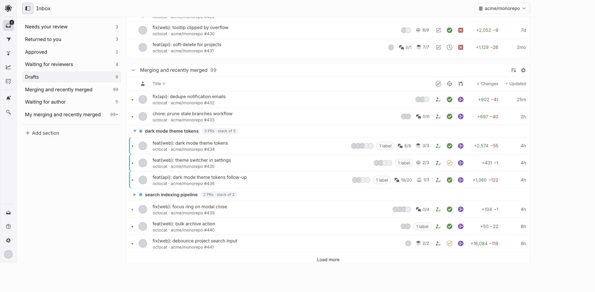

# Graphite Stack Groups

Chrome extension that groups PRs by stack in the [Graphite](https://app.graphite.com) inbox.

Graphite's inbox lists every PR as a flat row, even though the product is built
around stacked PRs. This extension groups same-stack PRs under a collapsible
header row:

- Each stack in a section gets a **header row**: chevron, a stable per-stack
  color chip, the top PR's title as the stack label, and a count like
  `2 PRs · stack of 4` (PRs of the stack in this section vs. the stack's full
  height).
- Stacks start **collapsed**; click the header to expand. Expanded members are
  ordered top-of-stack first and marked with the stack's color.
- PRs that aren't part of a multi-PR stack (in that section) are left alone.

## Install

1. Clone this repo.
2. `chrome://extensions` → enable **Developer mode** → **Load unpacked** →
   select the cloned folder.
3. Refresh your Graphite inbox.

After pulling updates, hit the reload icon on the extension in
`chrome://extensions` (Chrome caches content scripts).

## How it works

Graphite's inbox API (`/api/v1/graphite/section/prs`) returns a
`stack: { stackId, position, height }` object per PR that the UI never
surfaces. `intercept.js` runs in the page world, wraps `window.fetch` to read
those responses as the app makes them (no extra requests, no auth handling),
and forwards `{number, stackId, position, height, title, branch}` to
`group.js` via a CustomEvent. `group.js` matches inbox rows to stacks by the
PR number in each row's link, then inserts the header rows and reorders/hides
members.

The inbox is a live React app, so `group.js` is written to coexist with it
rather than fight it: regrouping is idempotent (zero DOM writes when the DOM
already matches), re-applies on a debounced MutationObserver after Graphite's
own re-renders, and a circuit breaker backs off if something re-triggers it
persistently.

## Caveats

- Built against Graphite's undocumented internal API and class names
  (`PrInboxTable*`); a Graphite redesign can break it silently.
- Stacks are keyed by PR number only, so two repos sharing a PR number in the
  same inbox could mis-group a row.
- Expand/collapse state resets on page load (stacks start collapsed).

## License

MIT
